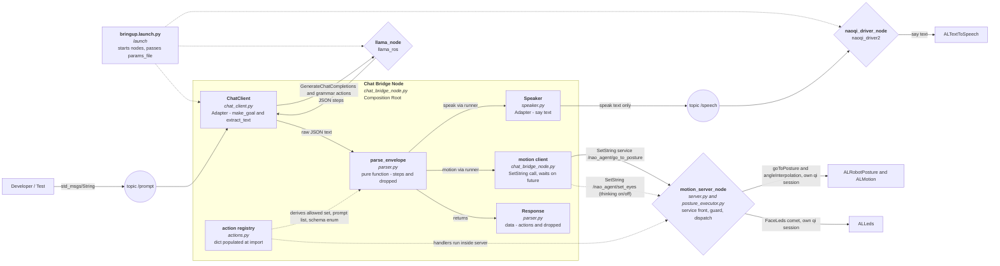

# Architecture Overview
This document describes the architecture of `nao_agent_ros2`: a ROS 2 agent
that gives the NAO6 robot conversational abilities by bridging a local LLM
(`llama_ros`) with the robot speech stack (`naoqi_driver2` / ALTextToSpeech).
It is a living document — update it as the codebase evolves.

## 1. Project Structure

```text
[src/nao_agent_ros2/]
├── nao_agent/                # Main Python package (ament_python)
│   ├── __init__.py
│   ├── chat_bridge_node.py   # Composition root / thin ROS wrapper (entry point)
│   ├── llm/                  # LLM adapter layer (no direct NAOqi knowledge)
│   │   ├── __init__.py
│   │   ├── chat_client.py    # Adapter for GenerateChatCompletions action
│   │   └── prompts.py        # Pure prompt logic, system prompt (no ROS deps)
│   ├── response/             # Envelope parsing (no ROS deps)
│   │   ├── __init__.py
│   │   └── parser.py         # Validates ordered action steps
│   ├── motion/               # Posture execution (own qi session)
│   │   ├── __init__.py
│   │   ├── actions.py        # @action registry (single source of actions)
│   │   ├── eyes.py           # thinking-eyes FaceLed animation + service name
│   │   ├── posture_executor.py # guard + dispatch (blocking run)
│   │   └── server.py         # ROS service fronts (posture + eyes)
│   └── speech/               # Speech adapter layer (no LLM knowledge)
│       ├── __init__.py
│       └── speaker.py        # Adapter for /speech -> ALTextToSpeech
├── config/
│   ├── params.yaml           # Single config: `chat_bridge_node:`, `motion_server_node:` + `/**:` model block
│   └── grammar/
│       └── response.json     # JSON Schema compiled to GBNF (envelope shape)
├── launch/
│   └── bringup.launch.py     # System composition: driver + LLM + bridge
├── test/
│   ├── test_parser.py        # pytest matrix for the envelope parser
│   ├── test_action_parity.py # registry/schema enum parity guard
│   ├── test_eyes.py          # eye animator tests with fake ALLeds
│   └── test_posture_executor.py # executor tests with fake qi services
├── resource/nao_agent        # ament package marker (do not touch)
├── .devcontainer/            # reproducible dev container (own workspace bootstrap)
│   ├── devcontainer.json     # mounts this repo at /home/ws/src/nao_agent_ros2
│   ├── devcontainer.containerfile # ROS Jazzy + choregraphe + tooling image
│   ├── setup-workspace.sh    # siblings, rosdep, full build (wheel pre-baked)
│   ├── start-sim.sh          # autostart naoqi-bin, pins NAO V6 robot model
│   └── bin/choregraphe       # one-word GUI launcher (needs forwarded X11)
├── dependencies.repos        # vcstool sources: naoqi_driver2, llama_ros
├── package.xml               # Package manifest (depends: rclpy, std_msgs, llama_msgs, naoqi_bridge_msgs)
├── setup.py                  # Build config + console_scripts entry points
├── setup.cfg                 # Script install dir
├── README.md                 # Package stub (see ARCHITECTURE.md for docs)
├── AGENTS.md                 # Agent guidelines (English comments, no gold plating)
├── .vscode/launch.json       # Debug config (rest of .vscode/ is ignored)
└── ARCHITECTURE.md           # This document
```

External (sibling source checkouts, not part of this repo):

```text
src/
├── llama_ros/                # LLM backend (llama_node, llama_msgs, llama_bringup)
└── naoqi_driver2/            # NAOqi <-> ROS 2 driver (naoqi_driver_node)
```

## 2. High-Level System Diagram

One diagram for everything:



Data flow: a test prompt injected on `/prompt` is wrapped into
`messages[]` (system + recent history + user) and sent as a
`GenerateChatCompletions` goal
constrained by `grammar_schema` to an ordered step list (`speak` texts and
named motion actions). The bridge walks the steps in a sequence runner:
speak steps publish to `/speech` (raw JSON never reaches speech), motion
steps run to completion one by one (own qi session). Single-flight covers
the whole sequence: a new prompt is dropped while one runs.

## 3. Core Components

### 3.1. chat_bridge_node

Name: `chat_bridge_node` (`nao_agent/chat_bridge_node.py`)

Description: Composition root and only ROS-aware orchestrator. Subscribes
to the prompt topic, drives the LLM action client through its callback
chain, then walks the ordered steps in a sequence runner (speak publishes,
motion goes through the motion service client with a future wait, abort
on failure). Holds no LLM/NAOqi logic itself — that lives in the `llm/`,
`response/`, `motion/` and `speech/` adapters. Keeps a short
conversation memory: the last `history_turns` exchanges (each message
clipped to `history_msg_chars`) are prepended to every goal;
in-process only, a restart forgets everything.

Technologies: Python, rclpy, rclpy.action

Deployment: ROS 2 node launched via `bringup.launch.py`; also runnable
standalone with `ros2 run nao_agent chat_bridge_node --ros-args --params-file ...`

### 3.2. ChatClient (llm adapter)

Name: `ChatClient` (`nao_agent/llm/chat_client.py`)

Description: Adapter over `llama_msgs/action/GenerateChatCompletions`.
Builds the goal (`messages`, `add_generation_prompt`, `use_jinja`,
`sampling_config.temp`, `sampling_config.grammar_schema` compiled to GBNF
server-side) and exposes non-blocking `send_async()` plus the
`extract_text()` result parser (strips BOS/EOS tag leaks).

Technologies: Python, rclpy.action, llama_msgs

### 3.3. Envelope parser (pure logic)

Name: `parser` (`nao_agent/response/parser.py`, schema `config/grammar/response.json`)

Description: Validates the ordered `actions` steps (`speak` with text,
motion names from the `@action` registry, unknown steps dropped and
reported, malformed input raises `EnvelopeError` and the answer is
dropped — raw JSON never reaches speech). Covered by a pytest matrix in
`test/test_parser.py` (`test_action_parity.py` guards the static schema
enum against the registry).

Technologies: Pure Python, JSON Schema, pytest

### 3.4. prompts (pure logic)

Name: `prompts` (`nao_agent/llm/prompts.py`)

Description: Framework-free message builder (`build_messages()`); the
prompt prose lives only in `config/params.yaml` (`system_prompt`), the
action list is composed at runtime from the `@action` registry, so the
two cannot drift. Testable without ROS.

Technologies: Pure Python

### 3.5. Motion service + executor (direct qi session)

Name: `server.py` + `PostureExecutor` (`nao_agent/motion/`)

Description: The ROS driver does not expose ALRobotPosture, so motion is
a first-class ROS service in our own package instead of a side channel:
`motion_server_node` serves `/nao_agent/go_to_posture`
(`naoqi_bridge_msgs/srv/SetString`: action name in, success out) on a
multithreaded executor and runs the
blocking NAOqi calls there.
`PostureExecutor` underneath only guards (single writer on ALMotion) and
dispatches registered `@action` handlers over its own qi session to the
same robot (concurrent sessions are allowed). The bridge is a plain
service client: it waits on the future (main thread keeps spinning) with
a timeout, skips motion gracefully when the server is down, aborts the
sequence on failure. Adding an action is one decorated method; the parser
set, prompt list and schema enum all derive from the registry. Requires
libqi-python (built from aldebaran/libqi-python, not on PyPI — see tech
note below).

Technologies: Pure Python + libqi-python, pytest

Eye animation (ported from `RobotEyes` in
[nao-agent](https://github.com/cybercoffeedev/nao-agent), the previous
plain-Python + qi implementation without ROS 2): the same node also
serves `/nao_agent/set_eyes` (`SetString`: `"thinking"`/`""` in, success
out). The bridge turns the rotating FaceLed comet on when a prompt is
accepted and off when the answer is handled; best effort, never blocks.
Covered by `test/test_eyes.py` with fake ALLeds.

### 3.6. Speaker (speech adapter)

Name: `Speaker` (`nao_agent/speech/speaker.py`)

Description: Publishes plain-text answers on the speech topic consumed by
`naoqi_driver2`'s `SpeechSubscriber`. Skips empty responses with a warning.

Technologies: Python, rclpy, std_msgs

### 3.7. Launch composition

Name: `bringup.launch.py`

Description: Declares `nao_ip`, `nao_port`, `params_file`
(default `config/params.yaml`, holding the `chat_bridge_node:`,
`motion_server_node:` and `/**:` model blocks) and
includes `naoqi_driver.launch.py`, `llama_bringup/base.launch.py` plus the
`chat_bridge_node` and `motion_server_node`.

Technologies: ROS 2 Launch (Python)

## 4. Data Stores

### 4.1. ROS graph (transient transport)

Name: Topics `/prompt`, `/speech`; action `generate_chat_completions`;
services `/nao_agent/go_to_posture`, `/nao_agent/set_eyes`

Type: ROS 2 DDS topics / action (in-memory, no persistence)

Purpose: `/prompt` carries test-injected user utterances
(`std_msgs/String`); `/speech` carries LLM answers to the driver;
the action carries chat goals/results including streaming feedback;
the services carry motion goals and eye-mode switches
(`naoqi_bridge_msgs/srv/SetString`).

Key Schemas/Collections: `std_msgs/msg/String`,
`llama_msgs/action/GenerateChatCompletions`,
`llama_msgs/msg/ChatMessage`,
`naoqi_bridge_msgs/srv/SetString`

### 4.2. Model artifacts

Name: GGUF model files (e.g. `bielik-7b-instruct-v0.1.Q4_K_M.gguf`)

Type: Local files, fetched from HuggingFace Hub per `llama_bringup` config

Purpose: Weights loaded by `llama_node` at startup; selected via
`params_file` (`/**:` model block).

## 5. External Integrations / APIs

llama_ros (`llama_node` + `llama_msgs`)

Purpose: Local LLM inference backend (chat completions only — that is
all the bridge uses).

Integration Method: ROS 2 action `GenerateChatCompletions`
(deployed server `/naoqi_driver/generate_chat_completions` via the
`llama_action` param; code default `/llama/generate_chat_completions`).

naoqi_driver2 (`naoqi_driver_node`)

Purpose: NAOqi <-> ROS 2 bridge; its `SpeechSubscriber` maps
`/speech` (`std_msgs/String`) to `ALTextToSpeech.say()`.

Integration Method: ROS 2 topic `/speech`.

NAOqi / naoqi-bin simulator (`ALTextToSpeech`)

Purpose: On-robot speech synthesis; the `naoqi-bin` simulator used in
development provides no audio output or microphone, so verification is
done by observing `/speech` traffic.

Integration Method: libqi session (`nao_ip`, `nao_port`, default
`127.0.0.1:9559`).

## 6. Deployment & Infrastructure

Cloud Provider: None (local robot / workstation deployment)

Key Services Used: ROS 2 Jazzy, colcon workspace (`/home/ws`),
DDS with `ROS_DOMAIN_ID=42`, `ROS_AUTOMATIC_DISCOVERY_RANGE=LOCALHOST`

Motion backend: libqi-python wheel baked into the dev image by a
builder stage (aldebaran/libqi-python + libqi 4.0.5, auditwheel-repaired,
self-contained). The executor imports it lazily — without the wheel the
bridge still talks, motion actions just fail with a clear log.

CI/CD Pipeline: None yet (manual `colcon build --packages-select nao_agent`)

Monitoring & Logging: ROS 2 logging (`/rosout`); key observables are the
`chat_bridge` prompt/LLM logs and `ros2 topic echo /speech`

## 7. Security Considerations

Authentication: None — trusted local network / localhost only.

Authorization: None — any host in the DDS domain can publish `/prompt`
and trigger speech and robot motion; do not expose the domain beyond the
lab network.

Data Encryption: None at the ROS layer (plain DDS on localhost).

Key Security Tools/Practices: `ROS_AUTOMATIC_DISCOVERY_RANGE=LOCALHOST`
to keep discovery off the wider network.

## 8. Development & Testing Environment

Local Setup Instructions:

```bash
source /opt/ros/jazzy/setup.bash
colcon build --packages-select llama_msgs nao_agent
source install/setup.bash
ros2 launch nao_agent bringup.launch.py nao_ip:=127.0.0.1 nao_port:=9559
# terminal 2: ros2 topic echo /speech
# terminal 3: ros2 topic pub --once /prompt std_msgs/msg/String "{data: 'Cześć, kim jesteś?'}"
```

Fresh machine: clone only this repo, reopen it in VS Code dev container
(`.devcontainer/`). First create recreates `/home/ws/src` (sibling
checkouts via `dependencies.repos`), installs rosdep deps and builds the
full workspace — long one time, skips on rebuilds. Sibling checkouts, apt
archives and colcon outputs live on named volumes; update pinned deps
with `git pull` inside `src/<repo>`. Container autostart (postStart):
naoqi-bin simulator with NAO V6 identity (robot model pinned to
`NAOH25V60.xml`, so Choregraphe opens a NAO, not a Pepper);
Choregraphe via the `choregraphe`
one-word launcher (needs X11 forwarding, never autostarted).

Testing Frameworks: `pytest` matrices (`test/test_parser.py`,
`test/test_action_parity.py`,
`test/test_posture_executor.py`); manual smoke checks (`make_goal` with
grammar, node init/destroy, envelope + motion E2E in the simulator).

Code Quality Tools: `py_compile` gate; `ament_flake8` / `ament_pep257`
declared as test dependencies.

## 9. Future Considerations / Roadmap

- Vision (LLaVA): swap `llama_node` for `llava_node` from the same
  `llama_ros` stack so the robot can see. `llava_node` serves the same
  `GenerateChatCompletions` action (the goal only gains
  `sensor_msgs/Image[] images`; grammar constraints are unchanged), so
  `ChatClient`, the envelope and the parser stay as-is and camera frames
  are fed per request. Requires camera images from the driver, `mmproj`
  weights in the model config, and a compute check (currently CPU-only
  inference).
- Real voice input: `whisper_ros` (wrapper over whisper.cpp) STT node
  consuming the driver's audio topic (`AudioBuffer` extraction, enabled
  in the driver by default) and publishing transcribed utterances to
  `/prompt`, replacing test injection. Hearing through the NAO6's
  built-in microphones requires a physical robot (`naoqi-bin` has no mic
  input); the STT pipeline itself is testable in simulation with audio
  files or the host microphone. Prerequisites: the driver's public audio
  endpoint (port forwarding, otherwise audio extraction is disabled),
  VAD/utterance segmentation, and echo gating (do not listen while the
  robot itself is speaking).
- Multilingual support: parameterize the interaction language instead of
  the hardcoded Polish `system_prompt` (per-language prompt text with the
  matching TTS voice and STT language), selectable via config/param.
  Speech synthesis stays on the robot via `ALTextToSpeech` (voice set per
  language); the bridge keeps publishing plain text to `/speech`.
- Runtime action remapping: recreate the `ActionClient` when the
  `llama_action` parameter changes instead of binding it once at startup.
- Speech-gated sequencing: pace the next step on the `TextDone` event
  from `ALMemory` instead of firing speak steps fire-and-forget (needs
  verification that `naoqi-bin` synthesizes the event).
- Persistent test suite under `test/` (goal building, speaker
  with a mocked publisher).
- VLA control (research track, last): once the agent is complete,
  experiments with a vision-language-action policy are planned in a
  separate repository (new ROS package in the same workspace, talking to
  this stack over topics only). Candidate action space is the driver's
  `cmd_vel` + `JointAnglesWithSpeed` (upper body; locomotion and balance
  stay with the walk engine). Discrete actions, the response envelope and
  the motion single-writer guard stay in this repo.

## 10. Project Identification

Project Name: nao_agent_ros2 (NAO6 conversational agent, ROS 2)

Repository URL: https://github.com/cybercoffeedev/nao_agent_ros2

Primary Contact/Team: cybercoffeedev

Date of Last Update: 2026-10-13

## 11. Glossary / Acronyms

NAOqi: SoftBank Robotics middleware/framework running on NAO robots;
exposes services such as ALTextToSpeech.

ALTextToSpeech: NAOqi service for speech synthesis (`say()`).

naoqi-bin: NAOqi simulator binary; no audio output or microphone support.

llama_ros: ROS 2 wrapper around llama.cpp exposing LLM inference as
actions/services (by Miguel Ángel González Santamarta et al.).

LLaVA: Large Language and Vision Assistant; `llava_node` (same
`llama_ros` stack) adds image understanding to the chat completions
action via a multimodal projector (`mmproj`).

VLA: Vision-Language-Action policy mapping images + language instruction
to robot control commands; research track, no off-the-shelf checkpoint
exists for the NAO embodiment.

GenerateChatCompletions: `llama_msgs` action for chat-style inference
(`messages[]` -> `choices[].message.content`).

GBNF: Grammar format (GGML BNF) constraining LLM sampling to a formal
grammar — used for the response envelope; planned extension: richer
robot actions.

GGUF: Model file format used by llama.cpp (e.g. Bielik Q4_K_M).

libqi: Aldebaran's NAOqi messaging library; the Python bindings drive
postures through a direct session, alongside the ROS driver.

Single-flight: Backpressure policy dropping new prompts while one LLM
goal or action sequence is in progress, avoiding overlapping `say()`
calls and motion conflicts.
